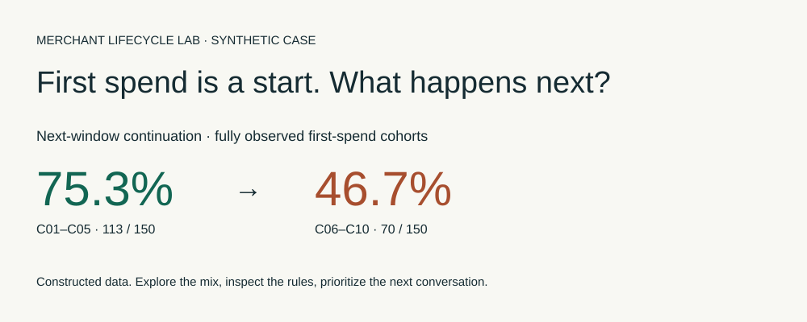
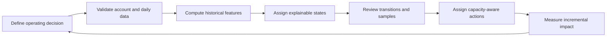

# Merchant Lifecycle Playbook

**Turn merchant activity into explainable growth and retention actions.**

For advertising platforms and marketplaces whose operations teams need to decide which merchants to onboard, support, grow or investigate for retention risk.



This project reconstructs the analytical workflow of a merchant lifecycle program: segment accounts, review movements, assign actions, and design a credible measurement plan. All included account data and results are synthetic. It contains no employer data, proprietary code or verified uplift claim.

## Start with the business decision

When every merchant receives similar outreach, account teams struggle to focus limited capacity. This playbook answers:

- Which new accounts need help reaching activation?
- Which growing accounts merit an efficiency and expansion review?
- Which established accounts show both spending and activity deterioration?
- How can we tell whether differentiated outreach actually helped?

Read the [sample diagnostic](reports/summary.md), inspect the [action queue](reports/action_queue.csv), or adapt the [data contract](docs/data-contract.md).

## Run the demo

Python 3.10+; no third-party packages or credentials required.

```sh
python3 lifecycle.py --generate-demo
python3 -m unittest discover -s tests -v
```

The generation flag creates or overwrites local synthetic data. Full daily records and historical snapshots are generated locally rather than committed. To analyze adapted inputs without regenerating them, run `python3 lifecycle.py`. Keep private client data out of public forks.

Outputs include account-level snapshots with explanations, a latest-period action queue, adjacent-window transition counts and row shares, and a Markdown diagnostic. Regeneration is deterministic with seed 42.

## How it works



| State | Demo interpretation | First operational action |
|---|---|---|
| Onboarding | Less than 30 days since account creation | Diagnose activation blockers |
| Growth | Spend growth above 10% and more than 10 active days | Check efficiency before scaling |
| Mature | Spend above category threshold; change within ±20% | Review performance and expansion fit |
| At-risk | Spend decline greater than 50% and fewer than 5 active days | Diagnose causes before incentives |
| Observe | Insufficient comparable history or no rule matched | Review; avoid automatic incentives |

Priority is Onboarding → data-history checks → At-risk → Growth → Mature → Observe. Growth takes precedence when it overlaps Mature. These are illustrative implementation choices, not universal lifecycle definitions or recovered production rules. Mature is a high-spend, stable segment in this demo; a smaller stable account is not therefore unhealthy.

## What transfers to other domains

Keep the decision process, explainable features, historical validation and action-to-measurement loop. Replace the entity, meaningful behavior, value metric, cadence and segment thresholds. Marketplace sellers might use fulfilled orders and selling days; SaaS accounts might use meaningful product adoption and renewal milestones. A 30-day advertising window is not automatically appropriate for either.

The original project experience informs the four-stage concept, category-aware thresholds, historical transitions and operator review. This implementation adds an explicit Observe bucket, deterministic precedence, data checks and reproducible synthetic inputs. See the [methodology in Chinese](docs/methodology.zh-CN.md), [data contract](docs/data-contract.md) and [measurement plan](docs/measurement.md).

## Working with Harry

I help advertising and marketplace teams turn fragmented merchant data into a practical growth and retention workflow.

A scoped diagnostic can include:

- A review of available data, business definitions and operating constraints.
- An explainable segmentation prototype and account-level action list.
- A lifecycle movement report and operator review session.
- A measurement plan for testing the proposed interventions.

To discuss a project, [open a scoping issue](https://github.com/harryli1998/merchant-lifecycle-playbook/issues/new?template=project-inquiry.md) with your platform type, operating challenge and desired decision. Share only a high-level description publicly; do not attach customer data or confidential business figures. Scope, timeline and outcomes depend on data readiness and implementation ownership. No fixed revenue increase is promised.

## Limits

This is an analytical reference implementation, not a production CRM or a trained churn model. It does not send outreach, optimize incentives, model seasonality, implement account-owner permissions or measure treatment effects. The category thresholds and queue ordering need validation with your business before use.

Code and documentation are available under the MIT license. Synthetic data are supplied for demonstration under the same license.
